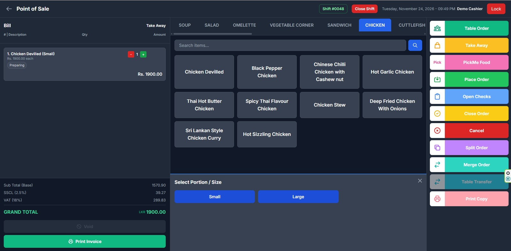
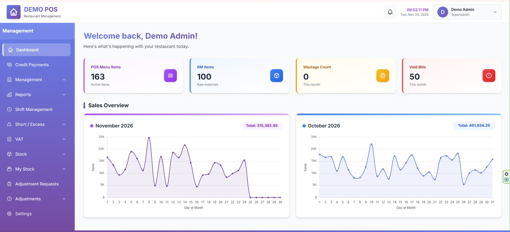

# 🍛 Restaurant POS System: Full-Service Restaurant Management

A complete **restaurant point of sale and management system** built for busy dine-in, take-away and delivery service. Cashiers and waiters manage tables and orders from a fast, dark-themed POS screen, while managers control menu, raw material stock, shifts, wastage and reports from the admin panel.

> 🔒 **This is a client project, so the source code is private.**
> This repository showcases the system's features and screenshots, taken from a demo setup.
> I'm happy to walk through the system and the code in an interview.

---

## 📸 Preview

---

## ✨ Features

### 🍽 POS Screen
- Three order types: **Table Order**, **Take Away** and **PickMe Food** delivery
- Menu organised in **category tabs** (Soup, Salad, Chicken, Sandwich and more) with item search
- **Portion / size selection** (e.g. Small or Large) when adding an item
- Live order status on each item (e.g. **Preparing**)
- Automatic **SSCL (2.5%)** and **VAT (18%)** calculation with a live grand total
- Dark theme designed for long shifts and touch screens

### 🧾 Order Management
- **Place, open, close and cancel** orders
- **Open checks** to see every running order
- **Split order** to divide one bill, and **merge orders** into one
- **Table transfer** to move an order to another table
- **Print invoice** and **print copy**
- **Void** items or bills, with every void tracked

### ⏱ Shifts & Security
- **Shift-based** cashier sessions with shift numbers and a close-shift process
- **Lock screen** so the POS can be locked when the cashier steps away
- Role-based access (e.g. Superadmin, Cashier)

### 📊 Admin Panel
- Dashboard with **active menu items**, **raw material items**, **wastage count** and **void bills**
- **Sales overview** comparing this month with last month, day by day
- **Stock management** for raw materials, plus **adjustments** with an approval flow
- **Short / excess** tracking
- **Credit payments**, **VAT** and detailed **reports**
- System **settings** and management

---

## 🛠 Tech Stack

| Layer | Technology |
|---|---|
| Backend | Laravel (PHP) |
| Frontend | Blade templates, JavaScript |
| Database | MySQL |

---

## 🖼 Screenshots

### POS Screen

### Admin Dashboard

> Screenshots are taken from a demo setup ("Demo POS") with demo data.

---

## 🎥 Demo Video

<!-- Drag your MP4 into the GitHub editor here, or paste an unlisted YouTube link -->
_Coming soon_

---

## 👨‍💻 Developer

**Tharaka Gunasinghe**, Full-stack Developer
[GitHub](https://github.com/Tharaka901) · [LinkedIn](https://linkedin.com/in/YOUR-LINKEDIN) · [Email](mailto:tharakamihiri@gmail.com)
